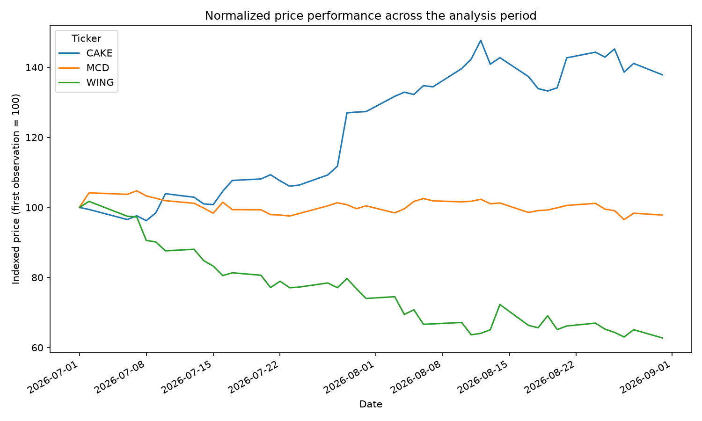
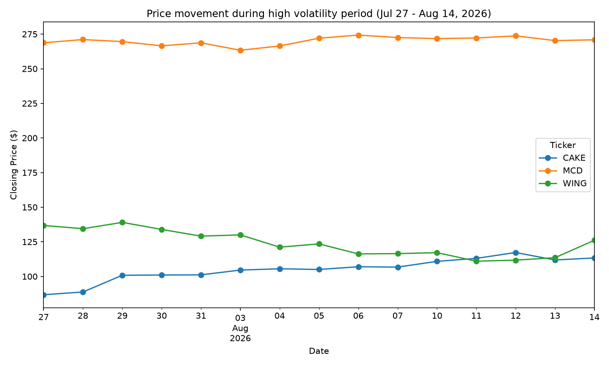
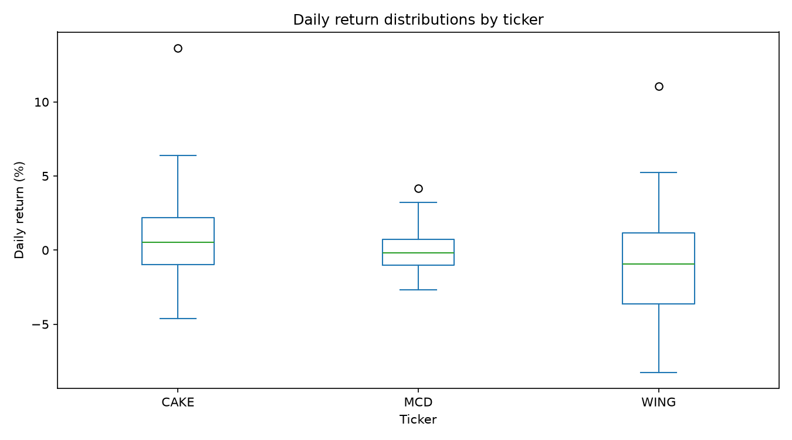
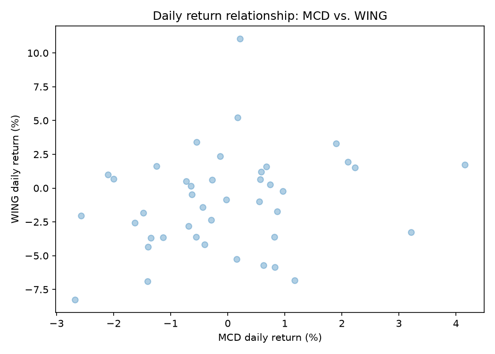

# Group_Project_1 

## Group Members
- Zidan Abdella
- Xinran Lyu
- Yubo Hua

## Stocks
- The Cheesecake Factory (CAKE)
- Wingstop (WING)
- McDonald's (MCD)

## Date Range
July 1, 2026 - August 31, 2026

## Business Reason
We selected three restaurant companies to compare their stock performance and examine how company-specific business events affected their stock prices during the same time period.

## Correlation Interpretation
The daily returns of MCD, WING, and CAKE show weak positive correlations. This suggests that the three restaurant stocks sometimes move in the same direction, but their daily price movements are mostly influenced by company-specific factors rather than moving closely together.

## McDonald's Significant Movement
On August 4, 2026, McDonald's released its second-quarter earnings and announced Skye Anderson as President of McDonald's USA. U.S. comparable sales increased only 0.8%, below market expectations, showing weaker U.S. performance.
Despite the weaker U.S. sales growth, MCD's stock rose about 1.17% on August 4, closing at $266.45, and rose another 2.11% on August 5, closing at $272.07. Trading volume on August 4 was about 7.49 million shares, higher than the following several trading days. This suggests investors reacted strongly to the earnings announcement, leadership change, and the company's plans to improve U.S. execution.

Sources:
- [McDonald's Reports Second Quarter 2026 Results](https://corporate.mcdonalds.com/corpmcd/our-stories/article/Q2-2026-results.html)
- [Reuters - McDonald's US sales growth slows as value push falters](https://www.reuters.com/business/mcdonalds-us-sales-disappoint-value-deals-fail-draw-enough-diners-2026-08-04/)
- [McDonald's Appoints Skye Anderson as President of McDonald's USA](https://corporate.mcdonalds.com/corpmcd/our-stories/article/skye-anderson-announcement.html)

## Wingstop's Significant Movement
According to the analysis from investing.com, it pointed out that Wingstop's stock has a significant slip on August 3rd due to their own stock-specific sentiment rather than any macro deterioration. So I grabbed the stock's data from August 3rd to 7th and found that the stock dropped 6.82% on August 4th and another 5.84% on August 6th. This was accompanied by an abnormal trading volume of 1,863,400 shares on August 4th as well.
In addition, from my data I found that the largest decrease return occurred on August 17th with an 8.25% drop. After searching the source, I noticed it might be influenced by missing on revenue as softer same-store sales weighed on the top line. As a result, its revenue and same-store sales fell short of Wall Street's estimates, then causing a significant drop in the stock during those days.

Sources:
- [Why is Wingstop stock sliding today? -from investing.com](https://ca.investing.com/news/stock-market-news/form-4-northern-oil--gas-jennifer-s-pomerantz-director-for-30-september-93CH-4876747)
- [Wingstop (NASDAQ:WING) Misses Q2 CY2026 Revenue Estimates. -from yahoo!finance](https://finance.yahoo.com/markets/stocks/articles/wingstop-nasdaq-wing-misses-q2-122406366.html)
- [Wingstop Inc. Reports Fiscal Second Quarter Financial Results. -from Wingstop](https://ir.wingstop.com/wingstop-inc-reports-fiscal-second-quarter-financial-results-4/)


Outputs:
```text
- Wingstop's Significant Daily Movements:
  Largest Increase Date: 2026-08-14 00:00:00
  Largest Increase Return: 11.050456181633471
  Largest Decrease Date: 2026-08-17 00:00:00
  Largest Decrease Return: -8.246115841573554

- Wingstop's Data Around Q2 Earnings:
  Price            Close   Volume
  Ticker            WING     WING
  Date                           
  2026-08-03  130.012222  1502800
  2026-08-04  121.147980  1863400
  2026-08-05  123.501144  1322700
  2026-08-06  116.282127  1480200
  2026-08-07  116.476562  1193000

- Wingstop's Returns Around Q2 Earnings:
  Date
  2026-08-03    0.695028
```


## The Cheesecake Factory's Significant Movement
On the evening of July 28, 2026 Cheesecake Factory released Q2 earnings which did surprisingly well and elicited a positive reaction causing the stock price to increase by %8.2 in one day from opening to close yielding a %13.62 increase from the day prior. 

Just about two weeks later on August 13 the stock price decreased largely in one day by %5.9, the daily return percentage, which compared the previous day's closing price to the current one is -4.61. 

Nothing specifically related to the company occurred on this day causing the decline, the decreasing stock price was mainly caused by an industry-wide selloff in casual dining and consumer discretionary stocks. Data showed an unexpected fall in retail sales including reduced foot traffic and lower credit card spending automatically leading many major funds to sell off in a coordinated manner. 

**Sources:**
- [Cheesecake Factory Reports Higher Profit, Sales](https://www.wsj.com/business/earnings/cheesecake-factory-reports-higher-profit-sales-bcaad9ad#)
- [The Cheesecake Factory Reports Results for Second Quarter of Fiscal 2026](https://investors.thecheesecakefactory.com/news-and-events/news-releases/news-release-details/2026/The-Cheesecake-Factory-Reports-Results-for-Second-Quarter-of-Fiscal-2026/default.aspx?utm_source=chatgpt.com)
- [Stock Of The Day Nearly Doubles This Summer, Poised To Extend Rally](https://www.investors.com/research/ibd-stock-of-the-day/cheesecake-factory-cake-stock-of-the-day/?utm_source=chatgpt.com)


## Work Item 6: Visualizations & Analysis
- Chart 1: Normalized-Price Performance

**Caption:** This line chart tracks the normalized price performance (rebased to 100) for MCD, WING, and CAKE. Across the period, the three stocks show completely different trends: CAKE experienced strong growth, surging from 100 to nearly 140; WING suffered a steep drop, falling toward 62; while MCD remained extremely stable around its starting value of 100.

- Chart 2: High Volatility Window Performance

**Caption:** This zoomed-in chart focuses on the high-volatility window from July 27 to August 14, 2026. During this three-week period, all three stocks showed frequent daily price swings. CAKE had the most noticeable upward fluctuations, whereas WING continued its downward trend.

- Chart 3: Daily Return Distribution

**Caption:** This boxplot highlights the distribution and spread of daily percentage returns. MCD has the narrowest box (between -1% and +1%), showing low risk and steady returns. In contrast, WING and CAKE have much wider boxes and visible outliers beyond 10%, indicating higher daily price volatility.

- Chart 4: Daily Return Relationship

**Caption:** This scatter plot illustrates the co-movement of daily returns between MCD and WING. Most data points cluster near the center (-0.5%, 0.5%), but a positive trend shows that when MCD experiences positive daily returns, WING often moves in the same direction, reflecting the whole restaurant market condition would be influenced together.
